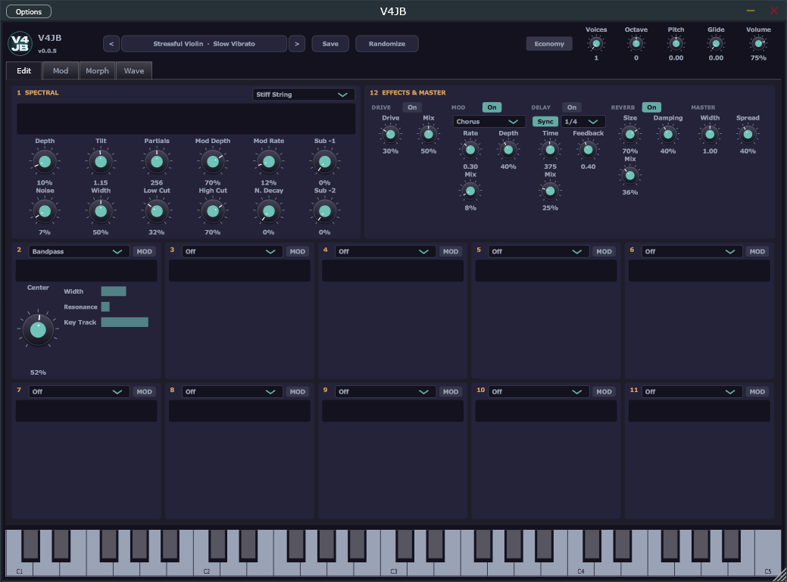
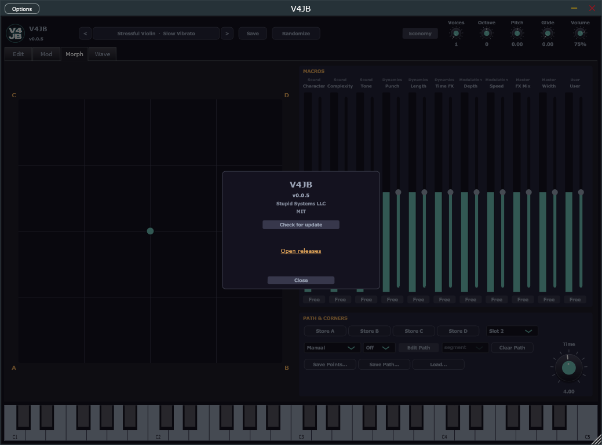
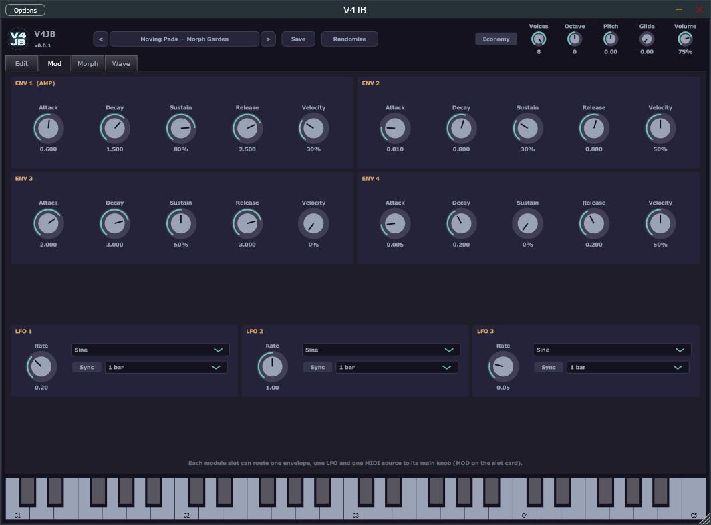
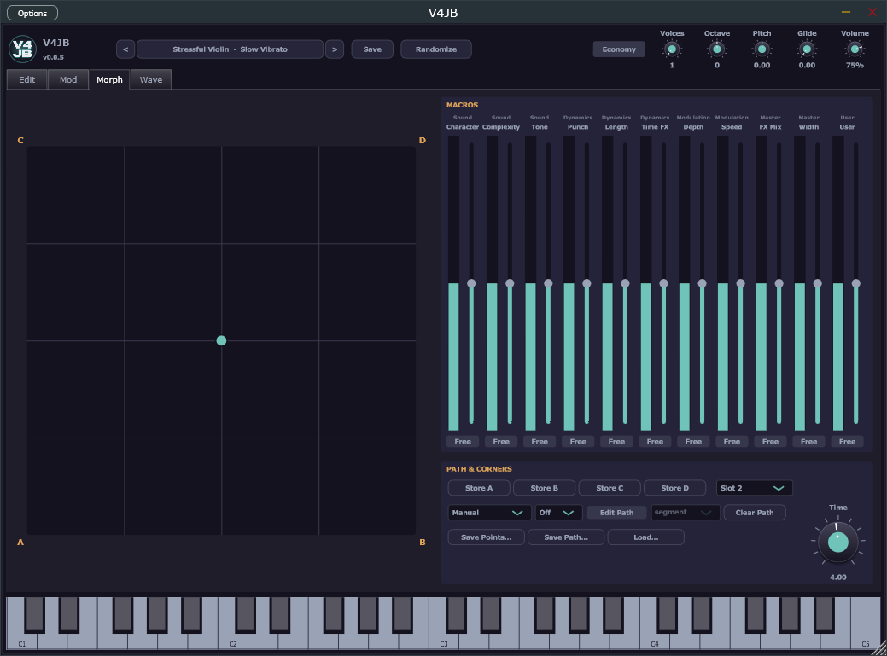
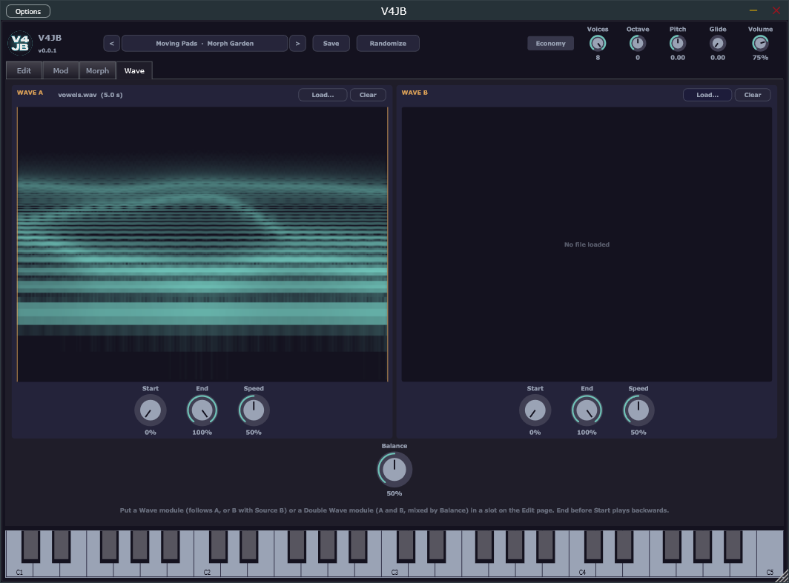

# V4JB – Manual

Atmosphere and texture. Pads, drones, air, fog. This is the walkthrough of the window: every tab, every card, every knob.

- [Install](#install)
- [How it makes sound](#how-it-makes-sound)
- [The window](#the-window)
- [Top bar](#top-bar)
- [About](#about)
- [Edit page](#edit-page)
- [Mod page](#mod-page)
- [Morph page](#morph-page)
- [Wave page](#wave-page)
- [Playing and MIDI](#playing-and-midi)
- [Factory presets](#factory-presets)

## Install

Run `V4JB-<version>-win-x64.msi`. Pick VST3, Standalone, or both. Defaults are `Common Files\VST3` and `Program Files\Stupid Systems LLC\V4JB`; each folder can be changed.

Or unzip `V4JB-<version>-win-x64-vst3.zip` into your VST3 folder, and/or unzip the standalone zip wherever you like.

In a DAW, scan for VST3 and load **V4JB**. In Standalone, pick your audio device and MIDI keyboard under **Options > Audio/MIDI Settings**.

## How it makes sound

Every note is a bank of sine waves (partials), up to 512 of them, plus two optional sub sines. Instead of 512 knobs, the sound runs through a chain of 12 slots that shape those partials:

1. **Slot 1, Spectral** (fixed): where the partials sit and how they start out (spacing, brightness, shimmer, noise).
2. **Slots 2–11**: pick any module per slot. They run in order, left to right then the second row. Order matters: a Lowpass before Random Drops is not the same as after.
3. **Slot 12, Effects & Master** (fixed): drive, chorus or phaser, ping-pong delay, reverb, stereo width. This is the only stage that works on the summed audio instead of the partial list.

The teal bars on each Edit card show the first 64 partials **after that slot**, for the last note you played. Empty bars mean no note has sounded yet.

Play from MIDI. Velocity, mod wheel, aftertouch and pitch bend ±2 semitones all work. The Standalone window also has piano keys along the bottom (C2 to C6). Up to 8 voices; when they run out, the oldest is stolen. **Economy** caps each voice at 128 partials, which is much lighter on the CPU and usually hard to hear.

## The window

The top bar is always there. Under it sit four tabs:

| Tab | What it is |
|---|---|
| **Edit** | The 12-slot chain: spectral stage, modules, effects |
| **Mod** | Four envelopes and three LFOs that slots can route |
| **Morph** | XY pad, 11 macros, path and corners |
| **Wave** | Two audio files that Wave / Double Wave modules follow |

Standalone adds the key strip. VST3 does not: the host already has keys. Drag the window corner to scale (40%–150%); the scale is saved with the session.

## Top bar

Left to right:

- **Logo + V4JB / version** — click for [About](#about).
- **Presets** — the current name (`category · name`). Click it for the list, grouped by category, plus **Save preset…** and **Open user preset folder**. `<` and `>` step through the list in that same order.
- **Save** — writes a user preset to `Documents\V4JB\Presets` as `Name.xml`. You get a name and a category (default **User**). Factory presets stay in the plugin; user presets show up in the menu next time.
- **Randomize** — two choices:
  - **New sound (new module chain)** — picks a short chain from a curated pool (Wave / Double Wave only if a file is loaded; at most one Double Wave) and new values.
  - **Vary values (keep modules)** — same slots, new numbers, still inside ranges that tend to sound like music.
- **Economy** — at most 128 partials per voice.
- **Voices** — 1 to 8. **1 is mono**: last-note priority, legato notes glide without restarting envelopes. 2–8 are polyphonic.
- **Octave** — −3 to +3 octaves on the whole instrument.
- **Pitch** — −12 to +12 semitones (fine transpose, on top of MIDI).
- **Glide** — 0–2 seconds. In mono, held notes slide to the new pitch. In poly it still slides each voice’s target.
- **Volume** — output level after the limiter.

## About

Click the title (logo / “V4JB” / version) to open the overlay.

- Version string matches the Projucer / installer version.
- **Stupid Systems LLC**, **MIT**.
- **Check for update** asks GitHub for tags. If a newer one exists, **Open releases** appears.
- Click outside the card, or **Close**, to dismiss.

## Edit page

This is the sound. Slot 1 and slot 12 sit on the top row. Slots 2–11 are two rows of five: 2–6 then 7–11, left to right.

### Spectrum bars

Each card’s bar graph is a tap after that stage. Play a note and they fill. They are a picture of the last voice that started, not a live analyser of the mix.

### Slot 1 — Spectral

Fixed. This is the starting spectrum before any module sees it.

**Algorithm menu** (labelled Distortion in the host): the spacing of the partials. **Depth 0** is a pure harmonic series (`n ×` the note). **Depth 1** is the full algorithm. The blend is in pitch (log-frequency), so 0.5 is halfway in octaves, not in Hertz. This is where metallic, bell and alien sounds come from.

| Algorithm | What the partials do | Use when |
|---|---|---|
| Stiff String | Slight piano-like stretch that grows with partial number | Acoustic, inharmonic highs |
| Stretch | All ratios pulled sharp (`n^1.1`) | Brighter clang |
| Compress | All ratios pulled flat (`n^0.88`) | Crowded, nasal |
| Bar | Free-bar modes ~`(2n+1)²` | Wood, mallet, xylophone |
| Membrane | Drum-head modes | Toms, skins |
| Primes | Prime ratios (1, 1.5, 2.5, 3.5…) | Bell-ish, not quite harmonic |
| Golden | Golden-ratio spacing | Alien stack |
| Octaves | Energy piled on octaves, slight chorus | Organ, power |
| Fifths | Stacked fifths | Open, hollow |
| Root | Dense low, more harmonic high | Drones with a root |
| Log | Crowded, inharmonic | Fog, sci-fi |
| Fold | First 24 harmonic, then folds back | Clustered mid |
| Even Shift | Even partials sharp | Beating evens |
| Odd Shift | Odd partials (above the fundamental) flat | Beating odds |
| Scatter | Fixed random scatter around harmonics | Dirty, broken harmonic |
| Bell | Church-bell ratios, hum below the strike | Struck metal |
| Offset | All overtones shifted by a constant | Clang, ring-mod flavour |
| Pairs | Adjacent partials slightly sharp/flat | Slow beating pairs |

**Knobs**

- **Depth** — 0 = harmonic series, 1 = full algorithm.
- **Tilt** — starting amplitude roll-off, `n^-tilt`. 0 is a flat buzz, ~1.2 is saw-like, 2+ is dark and soft. Range 0–3.
- **Partials** — how many sines, 1–512 (Economy still caps at 128). More highs, more CPU.
- **Mod Depth** — each partial drifts in pitch on its own, up to about 60 cents. Shimmer.
- **Mod Rate** — how fast that wander is, roughly 0.05–20 Hz. Partials do not all move at the same speed.
- **Noise** — crossfade from sine partials to noise partials. Each partial becomes a band of noise at the same frequency.
- **Width** (noise) — how wide that band is.
- **Low Cut / High Cut** — which partials get noise (highpass / lowpass of the noise, 20 Hz–20 kHz).
- **N. Decay** — 0 = noise stays on. Above 0 the noise is a breathy burst at note-on (chiff, breath).
- **Sub -1 / Sub -2** — clean sines one and two octaves below the note. Added **after** the module chain, so filters do not eat them.

### Slots 2–11 — module cards

Each card:

1. Slot number.
2. **Module menu**.
3. **MOD** — flips the lower half to modulation routes.
4. Spectrum bars after this slot.
5. Big **main** knob (name changes with the module).
6. Up to four extra sliders. Unused ones hide.

**Off** is a no-op: the spectrum passes through unchanged.

**MOD** (routes push **only the main knob**, not the extra sliders):

- One **envelope** source: Off, Env 1–4. Amount bar is bipolar; centre = none, right adds, left subtracts.
- One **LFO**: Off, LFO 1–3. Same bipolar amount.
- One **MIDI** source: Off, Velocity, Mod Wheel, Aftertouch, Key, Key+Vel. Key is 0 at C2 and 1 at C7. Key+Vel is the product.

Env 1 is still the loudness of the note even if you also route it here.

The three amounts can pile up; the engine then clamps the main knob to 0–1. The **Depth** morph macro scales all three amounts.

### Module catalogue

All extra knobs are 0–100% unless noted. “Use when” is a hint, not a rule.

#### Basic shapes

**5-Sines** — organ register. Main **Mask** fades everything above partial 5 away. **Sine 2–5** set those partials’ levels relative to the fundamental.

**Odd/Even** — **Balance** 0 = odd only (square-ish), 0.5 = all, 1 = even only. **Keep Fund.** above 50% leaves the fundamental alone.

**Sync** — hard-sync flavour: a formant hump that sweeps up the partials. **Sync** is the slave ratio. **Resonance** is the bump height. **Bright** tilts the rest of the spectrum.

**Adder** — boost a Gaussian lump of partials. **Center** picks which, **Width** how many, **Amount** how much.

**Discrete Adder** — boost every **Step**-th partial from **Offset**, cut the rest. **Discrete** thins the boosted set (every other boosted partial drops back) for sparse metal. **Amount** is the cut/boost.

**Every Nth** — keep every **N**th partial from **Offset**; **Depth** is how hard the others are cut.

**Harmonic Add** — adds four harmonics of a chosen **Base** partial (base, 2×, 3×, 4×). **Level 1–4** are those four.

**Range Enhance** — a bell EQ across partial numbers. **Center** is which partial (1–512), **Width** in octaves, **Amount** ±24 dB at centre.

**Clip** — no partial may be louder than **Threshold** below the peak (flattens the spectrum). **Makeup** restores level.

#### Filters and tone

**Lowpass / Highpass** — Butterworth-ish slope plus a resonant bump. **Cutoff** is the main knob (key-trackable). **Slope** 6–48 dB/oct. **Resonance**. **Key Track** 1 = cutoff follows the note (referenced to C4).

**Bandpass** — **Center**, **Width**, **Resonance**, **Key Track**.

**Notch** — **Center**, **Width**, **Depth** (how deep the hole), **Key Track**.

**Moving Filter** — a comb of notches on a sqrt-frequency scale, so they spread apart as they rise (a phaser does the opposite in Hz). **Position** slides the comb. **Density** how many. **Rate** how fast it crawls. **Depth** how deep.

**Decay** — higher partials die faster, like a plucked string. **Rate**, **Tilt** (how much faster the highs go), **Floor** (what remains).

**Hype** — two shelves, low and high. **Amount** scales both (at 50% you get ±18 dB, at 100% ±36 dB). **Low Freq / Low Gain**, **High Freq / High Gain**. Instant air or body.

#### Motion and doubling

**Modulator** — a travelling wave of loudness that rolls up through the partials. **Depth**, **Rate**, **Period** (how many partials per bump), **Sharp**.

**Detuned** — unison emulation. **Detune** up to 30 cents. **Style**: alternating sharp/flat, random per partial, or growing with partial number. **Beat** adds the slow amplitude beating you would hear between two detuned voices.

**Blur** — every partial’s level wanders. Fuzzy, out-of-focus. **Amount**, **Speed**.

**Noise** — a fresh random level per partial every control block. Grainy, hissy. **Amount**, **Color** (tilts the grain toward low or high partials).

**Octaver** — copies the spectrum up one and two octaves (partial `n` feeds `2n` and `4n`). **Up 1 Oct** is the main knob, **Up 2 Oct**, **Dry**.

**Second Tone** — splits the bank: even slots keep the first tone, odd slots become a second tone. **Interval** steps through a unison-ish detune, minor 3rd, major 3rd, 4th, 5th, octave, octave+5th, two octaves. **Level** of the second tone. **Detune** a few extra cents.

#### Rhythm

**Phrase** — spectral arpeggio on the beat clock (host position while playing, otherwise free-running at host tempo, 120 if none). Lights one of the low partials each step.

- **Pattern**: up, down, up-and-down, scattered, pulse, chord, trill, climb (8 steps).
- **Rate**: 1, 2, 4 or 8 steps per beat.
- **Depth**: how far unlit partials duck.
- **Partials**: how many of the lowest partials are in the game.
- **Smooth**: how fast it crossfades between steps.

**Random Drops** — random partials flare and fade (rain on tin). **Density**, **Decay**, **Floor**, **Range** (how high the drops reach), **Low Bias** (favour low partials).

**Tail** — each partial holds its peak and rings down: a spectral reverb that fills gaps left by Phrase or Drops. **Amount**, **Time**, **Damping** (highs die faster).

#### Wave followers

These need files on the [Wave page](#wave-page). With nothing loaded they do nothing.

**Wave** — each partial’s level follows how loud that frequency is in the file.

- **Amount** — dry spectrum vs followed.
- **Shift** — slide the file’s spectrum up or down in octaves against the partials.
- **Contrast** — exaggerate or flatten the file’s peaks.
- **Source B** — above 50% follow Wave B instead of A.
- **Freeze** — above 50% hold the **Start** frame instead of playing.

**Double Wave** — same, but A and B mixed.

- **Amount**, **Balance** (0 = A, 1 = B; the Wave page Balance and the Character macro also move this), **Shift**, **Contrast**, **Freeze**.

### Slot 12 — Effects & Master

Audio after the sine bank. Each effect has its own **On**. Mix knobs are also pushed by the **FX Mix** morph macro; **Width** is pushed by the **Width** macro.

**Drive** — tanh saturator. **Drive** is gain into the curve. **Mix**.

**Mod** — **Chorus** or **Phaser**. **Rate** 0.01–10 Hz, **Depth**, **Mix**.

**Delay** — ping-pong (each side’s echo feeds the other). **Sync** uses **Division** (`1/16`, `1/8`, `1/8 dot`, `1/4`, `1/4 dot`, `1/2`, `1 bar`) against host tempo. Off uses **Time** 10–2000 ms. **Feedback** 0–0.95. **Mix**. Turning it off and on again clears stale echoes.

**Reverb** — **Size**, **Damping**, **Mix**.

**Master** — **Width** 0 = mono, 1 = natural, 2 = extra wide (M/S). **Spread** pans odd partials one way and even the other (fundamental and subs stay centred). This Spread is applied in the sine bank, not here, but the knob lives on this card.

A safety limiter sits after this chain, then Volume.

## Mod page

Four envelopes on top, three LFOs below. The footer is the rule: **each module slot can route one envelope, one LFO and one MIDI source to its main knob** (MOD on the slot card).

### Envelopes

Per voice. **Env 1 (AMP)** is always the volume of the note. Env 2–4 exist to be routed.

- **Attack** — 1 ms–10 s, linear, from the current level (a retrigger never clicks).
- **Decay** — 1 ms–10 s, exponential toward Sustain.
- **Sustain** — level held while the key is down.
- **Release** — 1 ms–10 s, exponential; about 60 dB down after this time, then idle.
- **Velocity** — how much MIDI velocity scales this envelope. 0 = ignore velocity.

### LFOs

Global, shared by all voices. Bipolar (−1…+1).

- **Rate** — 0.01–20 Hz when Sync is off.
- **Shape** — Sine, Triangle, Saw, Square, S&H (new random value once per cycle).
- **Sync** — lock to the beat clock instead of Rate.
- **Division** when synced: `1/16`, `1/8`, `1/4`, `1/2`, `1 bar`, `2 bars`, `4 bars`, `8 bars`.

While the host plays, the clock is the transport. Otherwise it free-runs at the host tempo (120 BPM if the host does not send one). Phrase on the Edit page uses the same clock.

## Morph page

Eleven macros, each a “move a set of things at once.” The XY pad blends four snapshots of those macros. The teal puck is where you actually are.

### Macros

Each column:

- Group name (Sound / Dynamics / Modulation / Master / User).
- Macro name.
- **Meter** (teal) — live value after the pad and the offset. Neutral is 0.5.
- **Offset** slider — automatable, −0.5…+0.5, added on top. The DAW sees these as “Character Offset” and so on.
- **Free** — take this macro out of the pad. It sits at 0.5 plus the offset, so you can automate it without the puck fighting you.

What each macro actually moves (from the centre):

| Macro | Moves |
|---|---|
| Character | Spectral Depth, Noise mix, Double Wave / Wave-page Balance |
| Complexity | Partials count (×¼…×4), Tilt |
| Tone | Main knob of Lowpass, Highpass, Bandpass, Notch, Hype, Moving Filter, Sync; also Tilt |
| Punch | Amp attack shorter, amp decay, amp Velocity |
| Length | Amp decay, release, sustain |
| Time FX | Main knob of Phrase, Random Drops, Tail, Decay, Modulator, Blur |
| Depth | Spectral Mod Depth, and all slot route amounts (×0…×2) |
| Speed | Spectral Mod Rate, all LFO rates |
| FX Mix | Drive / Mod FX / Delay / Reverb mix |
| Width | Spread and master Width |
| User | Main knob of the slot in **User Macro Slot** (slots 2–11) |

### Corners and the pad

A is bottom-left, B bottom-right, C top-left, D top-right. The four snapshots mix bilinearly under the puck.

**Store A / B / C / D** — save what you hear into that corner, zero the offsets, jump the puck there. The sound does not jump.

Click a corner letter to recall it (moves Morph X / Morph Y, which the host can also automate).

### Modes

- **Manual** — drag the puck.
- **Path** — the puck travels a closed loop through the nodes. **Time** is seconds per bar of path.
- **Path Sync** — same loop, but bar lengths follow the host tempo.
- **X-Axis Env** — each new note from silence sweeps the puck left to right over **Time** seconds. Height is read off the path as a curve (nodes sorted by X). **Snap** (`Off`, `4`, `8`, `16`, `32`) steps that sweep for rhythmic morphs.

### Path editing

**Edit Path** — click to add a node (up to 16), drag to move, right-click to delete. Select a node and set **segment** (`1/4 bar` … `8 bars`): how long the trip **from this node to the next** lasts.

**Clear Path** removes every node. Path modes with fewer than two nodes sit still.

### Save / load

Files are `*.v4jbmorph` under `Documents\V4JB\Morph`.

- **Save Points…** — the four corners.
- **Save Path…** — the nodes.
- **Load…** — a points file leaves the path alone, and a path file leaves the corners alone.

## Wave page

Two files, A and B. A Wave module follows one of them; Double Wave follows both. **Nothing here makes sound by itself** — put a Wave or Double Wave module in a slot on Edit.

Each panel:

- Spectrogram: time left to right, frequency bottom to top, brightness = level. Amber lines are **Start** and **End**.
- **Load…** — built-ins first (**bells**, **chords**, **rain**, **vowels**), then **File…** (`wav`, `aif`/`aiff`, `flac`, `ogg`, `mp3`). Analysis runs on a worker thread (mono mix, up to 120 s).
- **Clear**.
- **Start / End** — region in the file. **End before Start plays backwards.**
- **Speed** — 0.25× to 4×. 50% is original speed. The file loops in that region.

**Balance** under the two panels is the A↔B mix for Double Wave (Character also moves it).

Built-in waves are remembered by name in presets. Your own files are remembered by absolute path; if you move the file, load it again. Factory presets in the Waves category bring the built-ins they need.

On Edit, Wave **Freeze** holds the Start frame. Double Wave **Balance** is this page’s Balance plus the module’s own Balance plus Character.

## Playing and MIDI

- **Polyphony** 1–8. Oldest voice stolen when full. Same key retriggers that voice.
- **Mono (Voices = 1)** — last note wins. Overlapping notes glide and do not restart envelopes.
- **Glide** — seconds to the new pitch.
- **Pitch bend** — ±2 semitones.
- **Mod wheel / aftertouch / velocity / key** — only if a slot’s MOD MIDI source is set.
- **Economy** — 128-partial cap. Use it on big chords if the CPU is tight.
- Standalone keys: C2–C6, mouse only (no QWERTY map). Host MIDI still works.

## Factory presets

494 presets in 18 categories, at least 10 in each. Between them they use every module, every spacing algorithm, all four morph modes and every modulation source. From number 16 on, each file in `presets/` starts with a one-line comment saying what the preset shows off; opening its Edit, Mod and Morph pages is a good way to learn a feature.

| Category | What you get |
|---|---|
| Atmospheres | Slow, noisy, reverberant spaces: blurred, dripping, drifting |
| Textures | Grainier beds: Noise module, Every Nth and sample-and-hold flutter, crackle |
| Pads | Soft sustained chords with gentle movement |
| Moving Pads | Pads that pulse or walk in time: Modulator, Phrase, synced LFOs, Path Sync morph |
| Swells | Long attacks that open up as they grow (Env 3 routes, X-Axis Env morph) |
| Drones | Held, evolving tones with subs, very slow LFOs and free morph paths |
| Organs | Instant, full-sustain registers: 5-Sines, Odd/Even, Discrete Adder, Octaver |
| Keys | Electric pianos, clavs, vibes: fast attack, decay, velocity on the tone |
| Bells | Struck and bowed metal: Bell, Bar, Primes spacing with Decay |
| Plucks | Short pitched plucks: guitars, harps, synth plucks |
| Percussive | Drums, blocks, shakers and clicks |
| Basses | Subs, plucks and growls, many mono with glide |
| Leads | Mono and duo leads with mod wheel, aftertouch and velocity routes |
| Polys | Chord sounds: brass, stabs, stacks; several in Economy for big chords |
| SFX | Sweeps, alarms, static, glitches |
| Waves | Built on the built-in waves: forwards, backwards, sliced, frozen, crossfaded |
| Stressful Violin | Long bowed tones, mostly violin: beating unisons, double stops, sul ponticello and tasto, plus cello, viola, and a few other strings |
| Thoughtful Violins | Warm, in-tune bows: slow attacks, pure fifths and octaves, small choirs. Little bow noise, no sour partials |

Good places to start: Fog Bank, Morph Garden (the morph pad), Vowel Choir and Rain Choir (the Wave page), Odd Machine (X-Axis Env with Snap), Fold Bass and Dream Rhodes.
